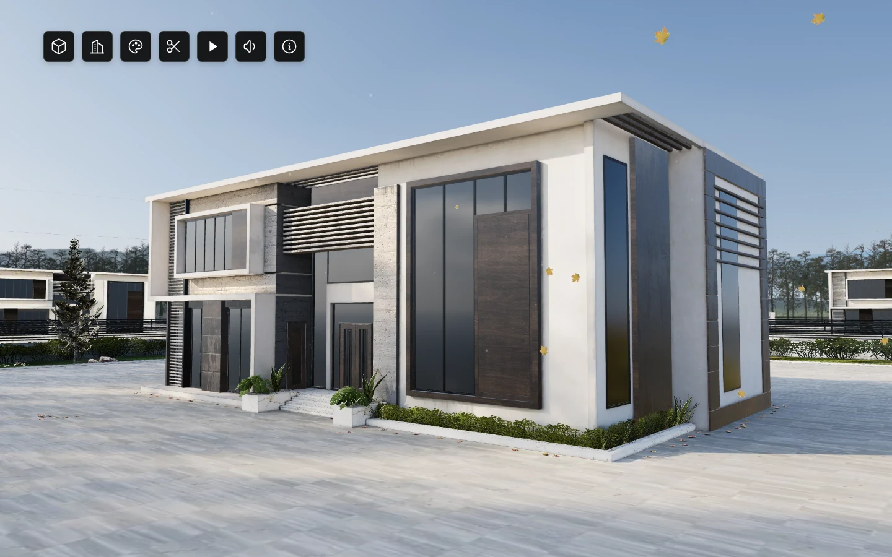
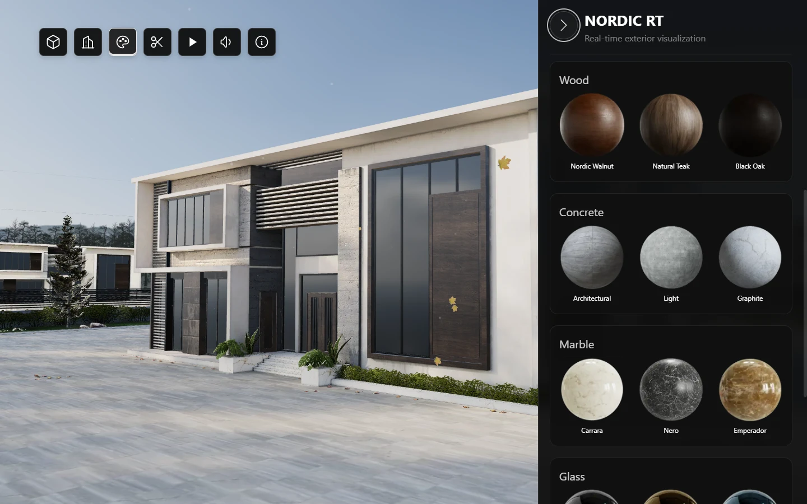
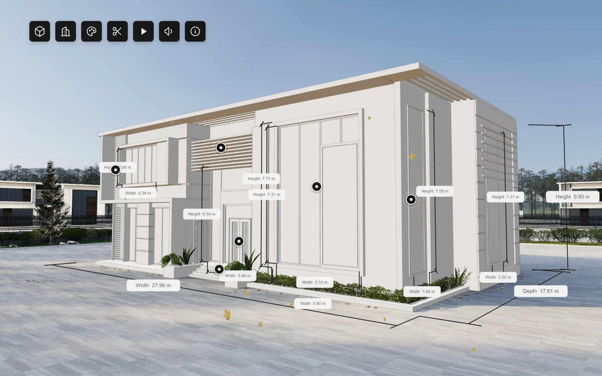
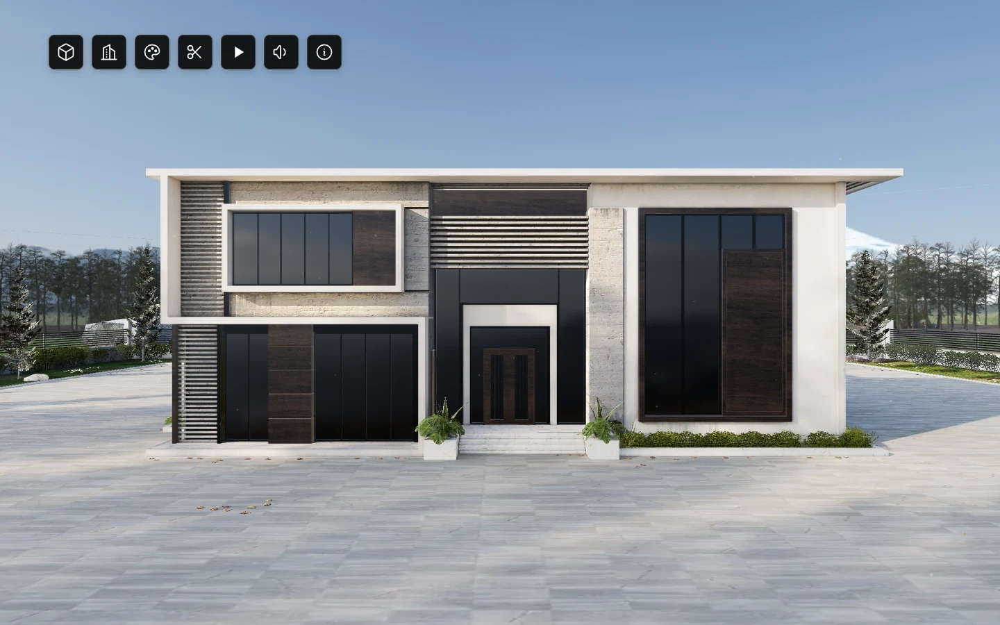
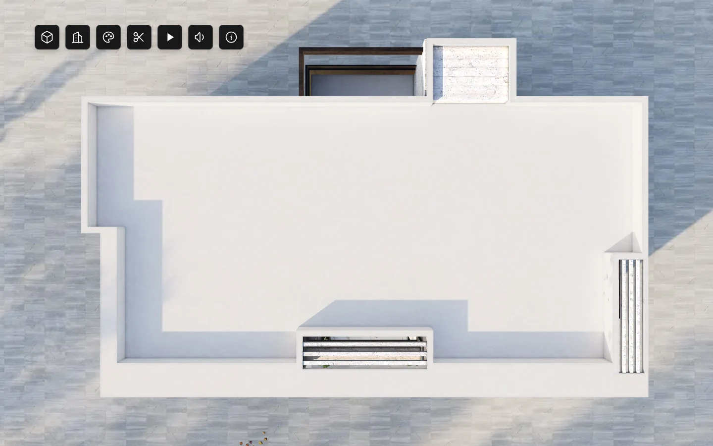
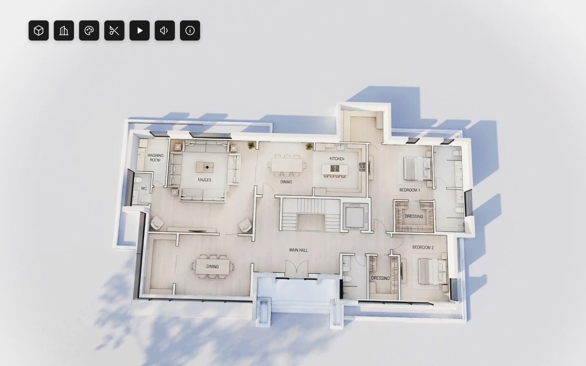
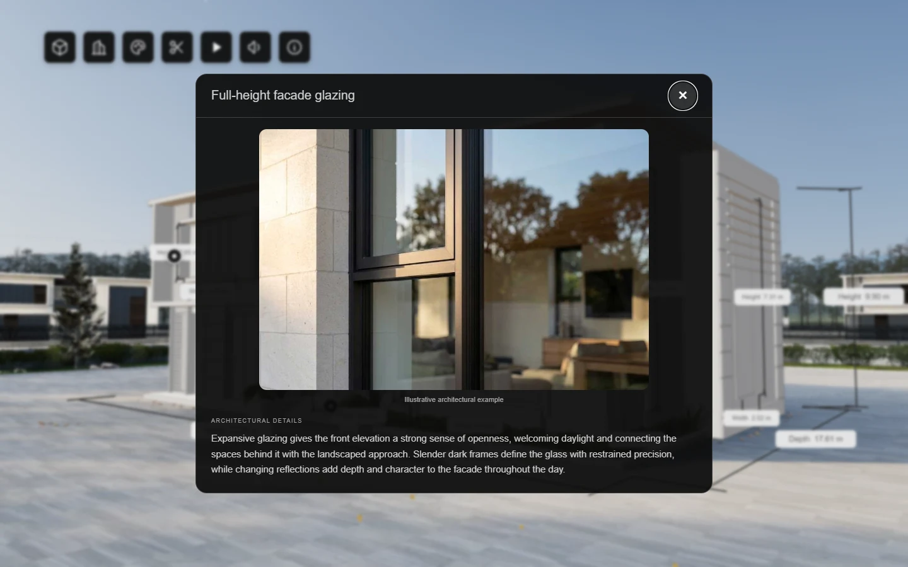
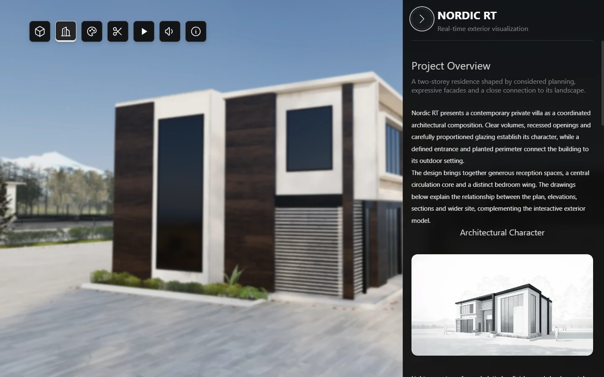
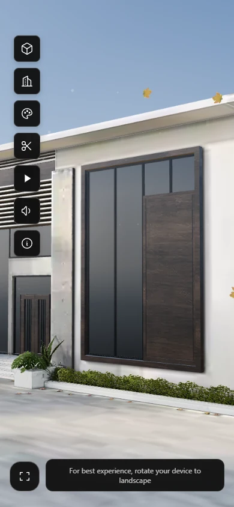
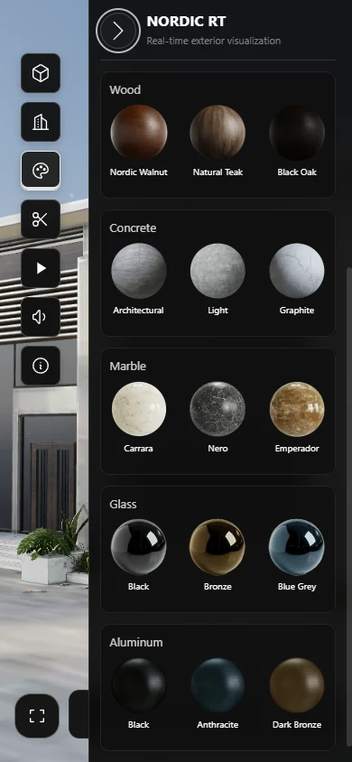

# Nordic RT — Architectural Exploration & Model Inspection

[**Explore the live experience →**](https://nordic-rt.nourtin.com/) · [Nour Altinawi / Nourtin](https://nourtin.com/)

An interactive architectural experience bringing **material exploration, model inspection, architectural views and illustrated project context** into the browser.

**Role:** Browser-based 3D development, material and lighting presentation, camera interaction, responsive interface design and architectural inspection tools.

**Platform:** Desktop and mobile web.

**Built with:** Three.js / WebGL, JavaScript, Vite, HTML and CSS.

## The project

Nordic RT presents a contemporary villa as a place to explore. Visitors can examine its exterior, compare finishes, study its form in Clay mode, move between architectural views and open explanations connected to visible building details.

The experience connects the 3D presentation with the drawings included in the viewer. The aim is to make the relationship between appearance, proportion, materials and architectural context easier to understand within one browser experience.

## Experience at a glance

| Area | What the visitor can do |
| --- | --- |
| Exterior exploration | Rotate and zoom around the villa and its landscaped setting. |
| Material finishes | Compare wood, concrete, glass, aluminium and planter finishes directly on the model. |
| Clay inspection | Study the main villa with a neutral finish, edge outlines and model dimensions. |
| Architectural views | Choose Front, Rear, Left, Right or Top. |
| Section presentation | Switch to a separate architectural section view. |
| Contextual details | Open eight illustrated architectural explanations from points shown during Clay inspection. |
| Project drawings | Read the overview alongside perspective, plan, facade, section and site drawings. |
| Mobile viewing | Use touch-oriented controls, compact drawers and fullscreen where supported. |

## 1. Explore materials in context

The Materials drawer groups the exterior finishes into clear families. Visitors can compare different wood, concrete, glass and aluminium appearances, together with the finish of the integrated planters.

Choices remain connected to the building in the scene, so materials can be judged alongside the facade, glazing and landscape rather than as isolated samples.

## 2. Inspect the architectural form

Clay mode gives the main villa a neutral presentation with restrained edge outlines. Overall and selected element dimensions appear around the model, while interactive points provide access to more specific architectural explanations.

The inspection remains available when the drawer closes, leaving more of the building visible.

*Dimensions describe the 3D model in metres. They are visual model annotations, not certified survey measurements, construction dimensions or a BIM deliverable.*

## 3. Compare architectural views

Front, Rear, Left and Right offer repeatable views of the facade composition. Top adds an overhead reading of the roof and footprint. Camera transitions keep movement continuous between selected views.

Visitors can choose a view while keeping the Materials drawer open, then continue exploring the exposed scene.

| Front view | Top view |
| --- | --- |
|  |  |

## 4. Read the section presentation

The section view offers another way to understand the model's spatial composition and the relationship between its levels and visible spaces.

It is a separate presentation of the architectural model. The exterior Clay tools and material choices belong to the main villa view.

## 5. Connect details and drawings to the model

During Clay inspection, eight points connect visible parts of the villa to concise explanations and architectural illustrations. Topics include glazing, the recessed entrance, steps, balcony, facade slats, entrance fins and the integrated landscape border.

The information stays within the viewer, giving visitors a closer explanation without losing the context of the building.

*Detail-panel images are illustrative architectural examples, not documentary photographs of a completed building or interchangeable model components.*

The Project Overview drawer complements the scene with the presentation drawings included in the experience. Its text follows the villa's architectural character, plan organisation, facade composition, sections and site context.

## 6. Explore on desktop and mobile

Desktop and mobile layouts keep the main controls close to the scene. On smaller screens, compact material groups, aligned samples and dedicated view buttons help visitors explore the available options.

Touch rotation and zoom support direct navigation. Fullscreen is available where the browser supports it, with landscape orientation requested where permitted. In mobile landscape detail panels, the illustration and explanation appear side by side.

  
  &nbsp;&nbsp;
  

*Mobile captures use browser viewport emulation. They show interface layout, not physical-phone performance validation.*

## My contribution

- Developed the browser-based architectural experience and connected its visual controls to the villa.
- Refined the material, lighting and camera presentation.
- Built the exterior Clay inspection, edge outlines and model-dimension annotations.
- Added the four facade views, Top view and section interaction.
- Connected model detail points to illustrated architectural explanations.
- Designed the Materials, Project Overview and About drawers across desktop and mobile layouts.
- Refined transitions, input handling and the overall viewing experience.

Nordic RT brings together **architectural visualization experience, frontend development and interactive 3D presentation**.

## Why it matters

Architectural communication involves both the overall impression and the details that explain it. Bringing material choices, repeatable views, model annotations and contextual drawings into one experience gives a project team or prospective client several ways to understand the same design.

This is a portfolio demonstration of that approach. It does not claim measured commercial outcomes or replace professional architectural documentation.

## Try the experience

1. Open **Materials** and compare the exterior finishes.
2. Enable **Clay** to inspect the form, dimensions and detail points.
3. Choose **Front**, **Rear**, **Left**, **Right** or **Top**.
4. Try the section view, then open **Project Overview** to explore the included drawings.

[**Open Nordic RT ?**](https://nordic-rt.nourtin.com/)

---

**About this repository:** A public portfolio presentation containing descriptions and screenshots captured from the published application on 27 October 2026. Application source, models, original asset packages and private engineering documentation are excluded. Images are viewer captures compressed for this page; they contain no developer diagnostics. Feature availability and fullscreen behavior depend on the viewing environment.

Browser 3D experience by [Nour Altinawi ? Nourtin](https://nourtin.com/).
